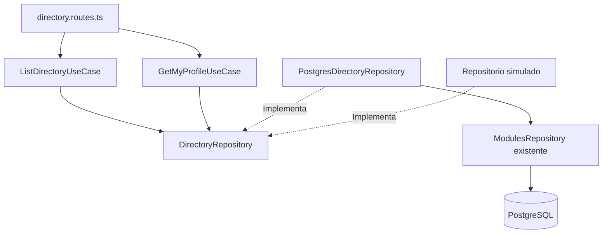

# FALCON - Arquitectura por capas

**Proyecto:** FALCON, piloto para el area de TI.
**Fecha del avance:** 19 de noviembre de 2026.
**Entrega prevista:** 24 de noviembre de 2026.
**Rama:** feature/capas-directorio-ti.
**Commit de referencia:** be44f2d.

## 1. Objetivo

Separar las responsabilidades de presentacion, API,
aplicacion, dominio e infraestructura, conservando
los contratos HTTP y PostgreSQL como base de datos actual.

La posibilidad de utilizar otro motor en el futuro
se representa mediante interfaces e inyeccion de
dependencias. No se implementa Oracle.

## 2. Capas

| Capa | Tecnologia o ubicacion | Responsabilidad |
| --- | --- | --- |
| Presentacion | frontend, Expo / React Native | Interfaz, estado y experiencia del usuario |
| API | backend/src/routes | Autenticacion, validacion HTTP y respuestas |
| Aplicacion | backend/src/application | Coordinar los casos de uso |
| Dominio | backend/src/domain | Contratos y reglas independientes de SQL |
| Infraestructura | backend/src/infrastructure y repositories | Acceso a datos y adaptadores PostgreSQL |

## 3. Dependencias del modulo Directorio



La aplicacion depende del contrato de dominio, no de
PostgreSQL. El adaptador implementa ese contrato.

El adaptador actual es transitorio: delega en
ModulesRepository y todavia no contiene SQL propio.

## 4. Archivos implementados

| Archivo | Responsabilidad |
| --- | --- |
| backend/src/domain/directory/directory.repository.ts | Contrato, tipos y reglas del Directorio |
| backend/src/application/directory/list-directory.use-case.ts | Caso de uso para listar colaboradores |
| backend/src/application/directory/get-my-profile.use-case.ts | Caso de uso para consultar el perfil propio |
| backend/src/routes/directory.routes.ts | Controladores HTTP |
| backend/src/infrastructure/postgres/directory.repository.ts | Adaptador PostgreSQL de transicion |
| backend/src/app.ts | Inyeccion de dependencias HTTP |
| backend/src/server.ts | Composicion con PostgreSQL |
| backend/tests/directory.layers.test.ts | Pruebas de dominio y aplicacion |
| backend/tests/directory.adapter.test.ts | Prueba del adaptador |
| backend/tests/api.test.ts | Contratos HTTP e inyeccion alternativa |

## 5. Contratos HTTP preservados

### GET /directory

Requiere autenticacion Bearer.

Parametros opcionales:
- search: texto de busqueda.
- area: filtro por area.

La validacion actual admite textos de 1 a 120
caracteres. Los filtros invalidos responden HTTP 400.

Respuesta exitosa:

```json
{
  "status": "ok",
  "items": [],
  "total": 0
}
```

### GET /profile/me

Requiere autenticacion Bearer.

Devuelve el perfil del usuario autenticado.
Si no existe un perfil disponible, responde HTTP 404.

## 6. Reglas de dominio iniciales

El listado muestra colaboradores activos.

El perfil propio requiere colaborador activo y
cuenta de usuario activa.

La consulta PostgreSQL existente ya incorpora
esas condiciones. Los casos de uso añaden una
verificacion independiente del repositorio.

## 7. Estado de los siete modulos

| Modulo | Estado arquitectonico |
| --- | --- |
| Inicio y cierre de sesion | Funcionalidad existente; no refactorizada por capas |
| Administracion, usuarios y roles | Funcionalidad existente; no refactorizada por capas |
| Quejas y seguimiento por folio | Funcionalidad existente; no refactorizada por capas |
| Directorio de colaboradores | Casos de uso, contrato y adaptador de transicion implementados |
| Perfil privado del empleado | Caso de uso y contrato implementados |
| Noticias y avisos internos | Funcionalidad existente; no refactorizada por capas |
| Bitacora de auditoria | Funcionalidad existente; no refactorizada por capas |

Las pruebas HTTP existentes cubren operaciones
representativas de los modulos, pero no prueban
su funcionamiento real con PostgreSQL.

## 8. Frontend y sincronizacion

La aplicacion Expo utiliza sincronizacion de datos
y almacenamiento local SQLite.

El Directorio de la interfaz utiliza un cache local
denominado directory_cache.

Por tanto, la ruta GET /directory y el flujo de
sincronizacion de Expo no deben presentarse
como si fueran una misma llamada.

La integracion completa entre Expo, sincronizacion,
SQLite y PostgreSQL sigue pendiente de verificacion.

## 9. Evidencia automatizada

Sobre el commit be44f2d se comprobaron:

- TypeScript: correcto.
- ESLint: correcto.
- Compilacion del backend: correcta.
- Pruebas automatizadas: 29 aprobadas, 0 fallidas.
- Prueba HTTP con repositorio alternativo: aprobada.

Los resultados corresponden a pruebas sin
conexion a PostgreSQL.

Para repetir las verificaciones:

```powershell
Set-Location "C:\Users\araha\Proyectos\falcon-capas-ti\backend"
& npm.cmd run typecheck
& npm.cmd run lint
& npm.cmd run build
node --import tsx --test tests/api.test.ts tests/directory.layers.test.ts tests/directory.adapter.test.ts
```

## 10. Limites y riesgos pendientes

1. El SQL del Directorio sigue dentro del repositorio compartido.
2. No se ha comprobado el recorrido real con PostgreSQL.
3. No se ha verificado el flujo completo en un dispositivo Expo.
4. Debe revisarse el aislamiento del cache SQLite entre usuarios.
5. Debe comprobarse que los campos del Directorio respetan
   las reglas de privacidad definidas para el piloto.
6. Los otros modulos aun no tienen casos de uso independientes.

## 11. Defensa tecnica

**Pregunta:** ¿Que pasaria si cambiara el motor de datos?

**Respuesta:** Los casos de uso del Directorio dependen
de DirectoryRepository y no importan pg ni SQL.
Podria implementarse otro adaptador compatible,
sin cambiar esos casos de uso ni el contrato HTTP.

Esto no significa que ya exista un adaptador para
otro motor. La implementacion operativa actual
continua utilizando PostgreSQL.

**Pregunta:** ¿Como se demuestra esa independencia?

**Respuesta:** Una prueba construye la aplicacion Express
con un repositorio alternativo y comprueba las respuestas
de GET /directory y GET /profile/me.

**Pregunta:** ¿Todo FALCON ya esta desacoplado?

**Respuesta:** No. La separacion se ha implementado
y probado primero en Directorio y Perfil.
Los otros modulos conservan su arquitectura existente.

## 12. Criterio para completar el siguiente avance

Verificar de forma controlada el acceso real a
PostgreSQL, revisar el recorrido de sincronizacion
del frontend y extender gradualmente los contratos
y casos de uso a otros modulos.
