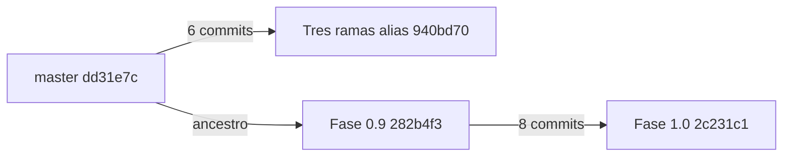
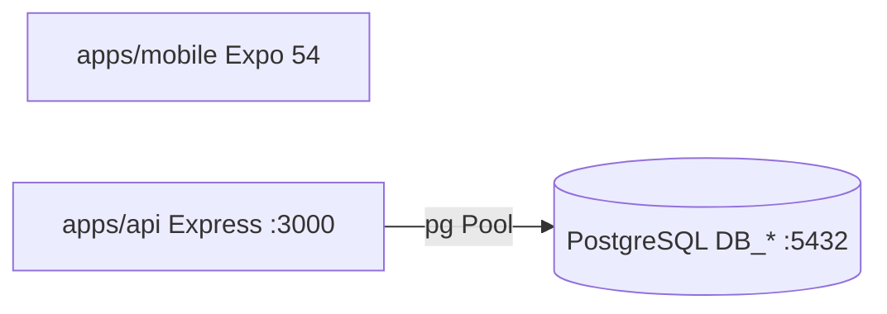
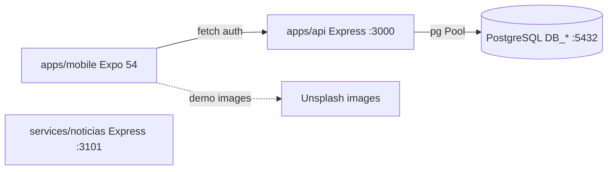
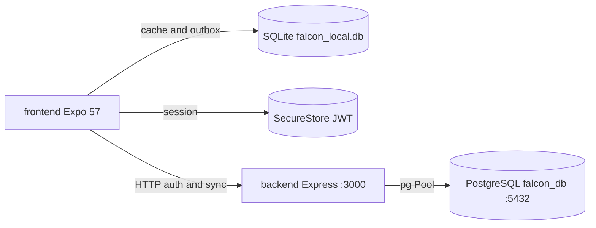

# Arquitectura actual comprobada por ramas

Fecha de corte: 16 de noviembre de 2026.

Los diagramas muestran sólo conexiones presentes en código. Una ausencia de
flecha significa que no se encontró comunicación versionada.

## Topología Git actual

Las tres ramas alias son `feature/falcon-noticias-service`,
`feature/falcon-gateway-infra` y `feature/sesion-web-falcon`.

## `master`

`master` contiene móvil y API, pero no se encontró en esa rama un cliente FALCÓN
que conecte el móvil con la API. La API sí conecta a PostgreSQL.

## SHA compartido `940bd70`

`services/noticias` aparece sin flechas porque sólo publica `GET /health`; no
hay consumidor, base, proxy ni llamada desde `apps/api`. La rama llamada gateway
no agrega ningún componente de gateway.

## Fase 0.9 y Fase 1.0

El mismo proceso `backend` sirve `/openapi.json` y `/docs`. PostgreSQL no se
expone al frontend; SQLite y SecureStore son locales a cada teléfono.

Fase 1.0 mantiene esta topología y sólo amplía el schema, seeds y pruebas.

## Ausencias comprobadas

- no API Gateway;
- no reverse proxy;
- no comunicación entre backends;
- no cola o broker;
- no Docker/Compose;
- no service discovery;
- no nube;
- no conexión directa móvil → PostgreSQL.
