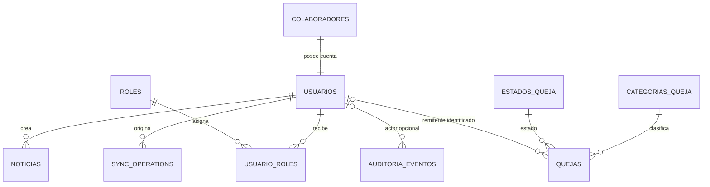

# Modelo de datos FALCÓN

Este documento refleja las migraciones `001_auth.sql`, `002_offline_sync.sql`
y `003_complaints_audit.sql`. No incluye entidades sociales no aprobadas.

| Entidad física | Propósito | PK | FK principales | Datos sensibles y privacidad |
| --- | --- | --- | --- | --- |
| `roles` | Catálogo de autorización | `id` | — | No |
| `colaboradores` | Identidad laboral separada de la cuenta | `id` | — | Nombre, correo e identidad laboral sintética en el seed |
| `usuarios` | Cuenta, hash bcrypt y estado de acceso | `id` | `colaborador_id` | `password_hash` nunca se expone |
| `usuario_roles` | Roles de cada cuenta | `(usuario_id, rol_id)` | `usuarios`, `roles` | Un solo rol principal por cuenta |
| `noticias` | Publicaciones sincronizables | UUID `id` | `creado_por` | Referencia al autor interno |
| `sync_state` | Versión central singleton | `id = 1` | — | No |
| `sync_operations` | Idempotencia y resolución de conflictos | UUID `id` | `usuario_id` | Usuario y payload operativo |
| `categorias_queja` | Catálogo de categorías | `id` | — | No |
| `estados_queja` | Flujo mínimo de estados | `id` | — | No |
| `quejas` | Quejas y sugerencias identificadas o anónimas | UUID `id` | categoría, estado, remitente opcional | Asunto y descripción; las anónimas exigen remitente nulo |
| `auditoria_eventos` | Trazabilidad mínima sin secretos | UUID `id` | actor opcional | No almacena password, hash, JWT ni identidad de remitente anónimo |
| `schema_migrations` | Registro interno del runner | `nombre` | — | No |

## Relaciones

## Restricciones e índices relevantes

- Número de empleado, correo, código de rol y folio son únicos.
- `usuarios.password_hash` debe tener formato bcrypt (`$2...`).
- Una queja anónima exige `remitente_usuario_id IS NULL`; una identificada
  exige una cuenta dummy válida.
- Los folios usan el formato opaco `FLC-XXXX-XXXX` y no incluyen número de
  empleado.
- Estados de queja: `RECEIVED`, `UNDER_REVIEW`, `RESOLVED`, `CLOSED`.
- `noticias.version` y `sync_state.version` protegen la sincronización.
- Hay índices sobre versión de noticias, operaciones por usuario, categoría,
  estado/fecha y remitente de queja, y consulta de auditoría por evento o
  entidad.

## Límites actuales

La migración agrega el almacenamiento aprobado para quejas y auditoría, pero
no agrega endpoints nuevos ni un workflow adicional. Muro social, likes,
comentarios, cumpleaños, aniversarios, beneficios y colaboradores destacados
permanecen fuera de alcance.

