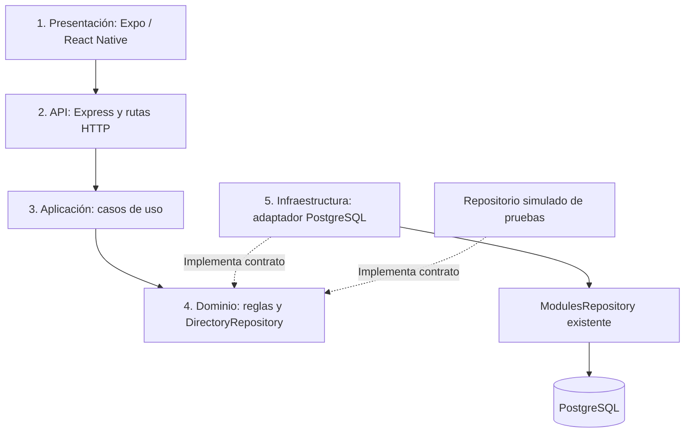
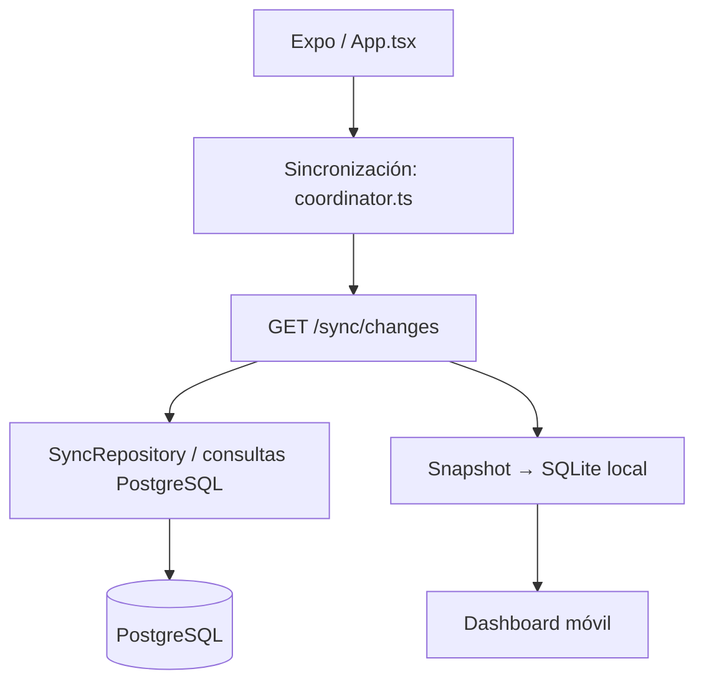

# FALCÓN — Estado técnico e integración del equipo

**Documento de coordinación técnica · 21 de noviembre de 2026**
**Responsable de este avance:** Ara
**Proyecto:** FALCÓN, aplicación para personal con frontend Expo/React Native, API Node/Express/TypeScript, PostgreSQL y almacenamiento offline SQLite.
**Entrega académica prevista:** 24 de noviembre de 2026.

> **Importante:** este README describe el estado comprobado en la máquina de Ara y el plan propuesto para integrar el trabajo del equipo. **No significa que todo esté fusionado, publicado ni probado de extremo a extremo.** Actualizarlo después de cada integración y ejecución verificable.

## 1. Resumen para el equipo

Hay **dos implementaciones relevantes que aún deben unificarse**:

- **`integration/falcon-unified-api`**, propuesta como base común: backend Express con PostgreSQL, autenticación, módulos funcionales y sincronización; frontend piloto en `frontend/`.
- **`feature/sesion-web-falcon`**, rama del trabajo visual de Ara: pantallas móviles en `apps/mobile/`, construidas con **Expo Router**.

Además:

- **`feature/falcon-noticias-service`** contiene trabajo del microservicio de Noticias, reportado por otro integrante como ejecutable en el puerto 3101 con 15 pruebas aprobadas. **Este reporte aún no ha sido reproducido por Ara sobre la base integrada.**
- **`feature/capas-directorio-ti`** contiene los cambios realizados por Ara sobre un worktree separado, creado desde la referencia local `origin/integration/falcon-unified-api` en el commit `623eb9b`: arquitectura por capas para Directorio/Perfil, documentación y aislamiento local por usuario.

**Camino A propuesto por el equipo:** utilizar `integration/falcon-unified-api` como base, llevar las pantallas de Ara al frontend integrado, incorporar el servicio independiente de Noticias sobre esa base y compatibilizar autenticación, permisos, almacenamiento y sincronización.

**Punto crítico:** conectar un microservicio en otro puerto **no demuestra por sí mismo** que el sistema entero sea de microservicios ni que los siete módulos implementen las cinco capas. La presentación debe distinguir arquitectura por capas de despliegue por servicios.

## 2. Estado comprobado a la fecha

| Área | Estado | Evidencia o límite |
| --- | --- | --- |
| Código de backend unificado | Base local disponible | `origin/integration/falcon-unified-api` estaba en `623eb9b` al revisar; falta `fetch` para confirmar actualidad remota. |
| Arquitectura por capas: Directorio y Perfil | Implementada localmente | Commit `be44f2d`. |
| Documentación de cinco capas | Creada | Commit `d57c86c`, archivo `docs/architecture/FALCON_LAYERED_ARCHITECTURE.md`. |
| Separación SQLite por cuenta y guardas de sesión | Implementada localmente | Commit `aae1721`, en `feature/capas-directorio-ti`. |
| Backend — pruebas seleccionadas | **29/29 aprobadas** | Pruebas HTTP, dominio, casos de uso y adaptador; sin PostgreSQL real. |
| Frontend — pruebas seleccionadas | **11/11 aprobadas** | Incluye simulación de respuestas tardías; sin ejecución en Expo nativo. |
| TypeScript / ESLint | Aprobados en ambos proyectos en las comprobaciones indicadas | El backend también compiló. |
| Pantallas de Ara | Localizadas, no integradas | `apps/mobile/app/(tabs)/`; falta adaptar navegación y contratos. |
| Servicio de Noticias | Rama localizada; integración pendiente | El equipo reporta puerto 3101 y 15/15 pruebas; falta verificar en esta integración. |
| Base de datos real | No alterada por los cambios de Ara aquí descritos | Ninguna migración o prueba de escritura ejecutada sobre `falcon_db` durante estos pasos. |
| End-to-end Expo → API → PostgreSQL → SQLite | **Pendiente** | No se debe afirmar que ya está validado. |

## 3. Ramas, worktrees y commits

### Ramas

| Rama | Uso |
| --- | --- |
| `origin/integration/falcon-unified-api` | Referencia de la base unificada propuesta. |
| `feature/sesion-web-falcon` | Trabajo original de Ara, con `apps/mobile/`; checkout en `C:\Users\araha\Proyectos\falcon-app`. |
| `feature/capas-directorio-ti` | Worktree de integración/arquitectura de Ara en `C:\Users\araha\Proyectos\falcon-capas-ti`. |
| `feature/falcon-noticias-service` | Rama del microservicio desarrollada en paralelo. |

### Commits locales de Ara sobre `623eb9b`

| Commit | Contenido |
| --- | --- |
| `be44f2d` | `refactor(directory): introduce layered architecture and dependency injection` |
| `d57c86c` | `docs(architecture): document layered directory implementation` |
| `aae1721` | `fix(frontend): isolate SQLite data by account and guard session sync` |

**Estos commits estaban en la rama local `feature/capas-directorio-ti` y el worktree quedó limpio.** No hay evidencia de que se hayan publicado al remoto. Los compañeros **no pueden verlos solo por existir localmente**: habrá que publicar una rama nueva y abrir una revisión/PR, una vez acordado con el equipo.

No ejecutar `git push` sin comprobar rama y destino. La rama de arquitectura se originó desde la rama remota de integración y su configuración de seguimiento debe revisarse antes de cualquier publicación.

## 4. Arquitectura que se puede demostrar

Se utiliza una separación de **cinco responsabilidades** para el segmento implementado de Directorio/Perfil:



### Implementación concreta

- `backend/src/domain/directory/directory.repository.ts`: contrato, tipos y reglas de visibilidad.
- `backend/src/application/directory/list-directory.use-case.ts`: listado de colaboradores activos.
- `backend/src/application/directory/get-my-profile.use-case.ts`: perfil propio disponible si colaborador y cuenta están activos.
- `backend/src/routes/directory.routes.ts`: control HTTP de `GET /directory` y `GET /profile/me`.
- `backend/src/infrastructure/postgres/directory.repository.ts`: adaptador **transitorio** que delega en el repositorio existente.
- `backend/src/app.ts` y `backend/src/server.ts`: inyección/composición de dependencias.

**Limitación relevante:** todavía no se ha extraído el SQL de `ModulesRepository` a un repositorio exclusivo del Directorio. Los otros módulos mantienen su estructura existente. **Oracle no está instalado ni conectado:** usar otro motor es un ejemplo de extensibilidad por interfaz, no una migración efectuada.

### Recorrido distinto: sincronización móvil

El frontend piloto original utiliza otro camino:



El endpoint `/sync/changes` **no pasa actualmente por los casos de uso nuevos del Directorio**. Por tanto, no debe presentarse como el mismo recorrido que `/directory`.

## 5. Trabajo frontend de Ara y adaptación requerida

### Pantallas encontradas en el proyecto original

`apps/mobile/app/(tabs)/` contiene, entre otras:

- `directorio.tsx`
- `perfil-colaborador.tsx`
- `noticias.tsx`
- `noticia.tsx`
- `index.tsx`

El proyecto de Ara usa **Expo Router**, mientras que la base unificada tiene un frontend en `frontend/App.tsx`. **No conviene copiar pantallas sin migrar la navegación y las dependencias**. Se recomienda tomar una pantalla a la vez, mantener el diseño y adaptar el consumo de datos a los endpoints y esquemas reales.

**Orden sugerido:** Directorio → Perfil → Noticias/listado → Detalle de noticia; conservar login, permisos y estados de sincronización. Este orden es una propuesta técnica, no una integración ya completada.

### Aislamiento móvil añadido por Ara

- `frontend/src/storage/account-scope.ts`: nombre de archivo SQLite según `user.id` y validación de propietario.
- `frontend/src/storage/database.ts`: selección de base por usuario (`falcon_user_<id>.db`).
- `frontend/src/sync/engine.ts` y `coordinator.ts`: operaciones vinculadas a la cuenta y verificación de sesión vigente frente a respuestas tardías.
- `frontend/App.tsx`: protección de UI al cerrar/cambiar sesión.

**No se borra ni migra automáticamente** `falcon_local.db`, que puede contener operaciones offline antiguas sin propietario identificado. El aislamiento de archivos **no equivale a cifrado**, y su comportamiento en dispositivo aún requiere pruebas.

## 6. Noticias: decisión de integración pendiente

El equipo propone levantar `services/noticias/` en **3101**, conservando el backend principal en **3000**. Antes de integrar hay que acordar:

1. **Responsabilidad de escritura:** ¿quién crea, modifica y versiona las Noticias, la API unificada o el servicio?
2. **Fuente de datos:** ¿ambos consultan la misma base PostgreSQL y cómo se controla el acceso?
3. **JWT:** adaptar el servicio al identificador `userId` y verificar firma, expiración, roles y autorización, sin asumir compatibilidad por el simple nombre del campo.
4. **Sincronización offline:** asegurar que las operaciones en cola mantengan un único proceso de validación/idempotencia y que el contrato `/sync/changes` no quede desactualizado.
5. **Rutas consumidas por Expo:** especificar qué URL/base y qué servicio atiende cada pantalla; no duplicar funcionalidad por accidente.

La prueba «15/15» y el puerto 3101 proceden del reporte del equipo, **no de una ejecución reproducida en este worktree**.

## 7. Pruebas y reproducción del avance local

**Entorno revisado:** Windows PowerShell, Node.js 24.x, npm 11.x. Utilizar `npm.cmd` en PowerShell, porque `npm.ps1` puede estar bloqueado por la política de ejecución.

### Backend (pruebas seleccionadas)

```powershell
Set-Location "C:\Users\araha\Proyectos\falcon-capas-ti\backend"
& npm.cmd run typecheck
& npm.cmd run lint
& npm.cmd run build
node --import tsx --test tests/api.test.ts tests/directory.layers.test.ts tests/directory.adapter.test.ts
```

Resultado de referencia: **29 pruebas aprobadas, 0 fallidas**, sin conexión a PostgreSQL real.

### Frontend (pruebas seleccionadas)

```powershell
Set-Location "C:\Users\araha\Proyectos\falcon-capas-ti\frontend"
& npm.cmd run typecheck
& npm.cmd run lint
node --import tsx --test tests/account-scope.test.ts tests/api-config.test.ts tests/sync-coordinator.test.ts tests/sync-session-guard.test.ts
```

Resultado de referencia: **11 pruebas aprobadas, 0 fallidas**. Las pruebas de cambio de sesión usan simulaciones de red y almacenamiento, no un teléfono ni SQLite nativo.

### Seguridad y operaciones

- No ejecutar migraciones, comandos de borrado ni escrituras contra `falcon_db` para «probar integración» sin respaldo y autorización del responsable.
- No publicar `.env`, claves, credenciales, JWT ni volcados de PostgreSQL en Git, mensajes de equipo o reportes.
- Validar el contrato del JWT y la autorización del microservicio antes de habilitar operaciones reales.
- Verificar la rama y `git status` antes de aplicar cambios, fusionar o publicar.

## 8. Plan de integración y responsables por confirmar

| Orden | Trabajo | Criterio de terminado | Estado |
| --- | --- | --- | --- |
| 1 | Publicar el avance de Ara en una rama revisable | PR/merge request hacia base consensuada, sin sobrescribir trabajo | Pendiente |
| 2 | Confirmar la referencia remota actual de `unified` | `git fetch` y comparación de commits/contratos | Pendiente |
| 3 | Migrar Directorio de `apps/mobile` a frontend integrado | Pantalla visible con datos correctos, login y control de errores | Pendiente |
| 4 | Migrar Perfil | Perfil correcto del usuario autenticado, sin exposición entre cuentas | Pendiente |
| 5 | Migrar Noticias y detalle | Listado/detalle coherentes con permisos y contrato API | Pendiente |
| 6 | Integrar el microservicio de Noticias | JWT, dueño de escrituras, rutas y pruebas documentadas | Pendiente |
| 7 | Validar Expo ↔ API ↔ PostgreSQL ↔ SQLite | Demostración con cuentas de prueba, offline y cambio de sesión | Pendiente |
| 8 | Preparar defensa de arquitectura | Diagrama real, límites, comandos y evidencia repetible | Pendiente |

**Criterio de calidad:** preferir una pantalla funcional conectada a la API real sobre cuatro pantallas que solo muestren datos simulados. Mantener registradas las limitaciones; no declarar terminada una integración sin reproducirla.

## 9. Registro de trabajo y comunicación

Al terminar cada tarea, anotar aquí o en el PR:

| Fecha | Rama / commit | Cambio | Pruebas | Pendiente |
| --- | --- | --- | --- | --- |
| 19–20 nov 2026 | `be44f2d` | Capas para Directorio/Perfil | Backend 29/29 | PostgreSQL E2E |
| 19–20 nov 2026 | `d57c86c` | Documento de arquitectura | Revisión de estructura | Actualizar con integración |
| 20–21 nov 2026 | `aae1721` | SQLite por cuenta y guardas de sincronización | Frontend 11/11 | Expo nativo y migración de datos antiguos |
| Por realizar | Sin commit | Migración de pantallas de Ara | No ejecutadas | Integración con API unificada |

## 10. Próxima acción inmediata

Se generó en la máquina de Ara el reporte local:

`C:\Users\araha\AppData\Local\Temp\FALCON_REPORTE_INTEGRACION_ARA.txt`

Su salida informó **35 archivos móviles revisados, 8 rutas backend y 4 archivos del servicio localizados**, con un tamaño de 139 087 bytes. **Ese archivo aún no ha sido adjuntado ni analizado aquí**: su creación no equivale a revisar compatibilidad de código. Compartirlo únicamente después de comprobar que no contiene secretos, tokens o datos personales.

Con el reporte revisado, elaborar un mapa pantalla → endpoint → esquema y comenzar la migración de una primera pantalla sobre la base unificada acordada.

---

**Regla de colaboración:** no fusionar directamente hacia `integration/falcon-unified-api` ni empujar cambios a su referencia remota desde ramas que la siguen automáticamente. Trabajar mediante ramas de tarea, cambios acotados, pruebas y revisión compartida. Los dueños de cada módulo deben confirmar las decisiones antes de modificar interfaces compartidas.
