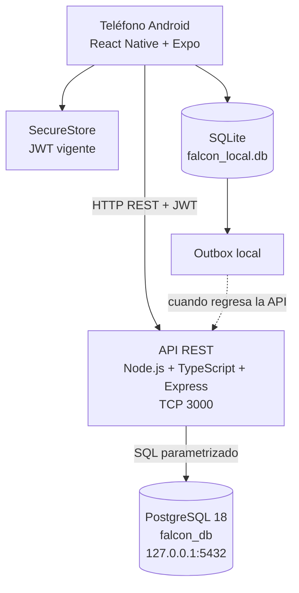

# Proyecto FALCÓN — Fase 0.9

## Resultado

**FASE 0.9: IMPLEMENTADA Y VALIDADA AUTOMÁTICAMENTE.**

**VALIDACIÓN FÍSICA: PENDIENTE.**

Esta fase desacopló la aplicación móvil, la API y PostgreSQL, y añadió una
copia local offline-first. Antes, el proyecto no tenía completa la separación
entre interfaz, autenticación, acceso SQL y sincronización. Después quedó esta
arquitectura:



No hay una nube activa en el piloto. La computadora host debe estar encendida
para que los teléfonos intercambien cambios con PostgreSQL.

## Componentes implementados

### Backend

- Node.js 24, TypeScript y Express.
- PostgreSQL mediante `pg`, sin ORM.
- Configuración validada en `backend/src/config/env.ts`.
- Repositorio SQL central en `backend/src/repositories/postgres.repository.ts`.
- OpenAPI en `/openapi.json` y Swagger UI en `/docs`.

Endpoints reales:

| Método | Ruta | Protección | Propósito |
| --- | --- | --- | --- |
| GET | `/health` | Pública | Salud del proceso HTTP |
| GET | `/health/db` | Pública | Conectividad con PostgreSQL |
| POST | `/auth/login` | Rate limit | Login con `employeeId` y password |
| GET | `/auth/me` | Bearer JWT | Sesión vigente |
| POST | `/auth/logout` | Bearer JWT | Revocación mediante `token_version` |
| GET | `/admin/ping` | Bearer + `administrador` | Verificación de autorización |
| GET | `/sync/changes` | Bearer JWT | Perfil, directorio y noticias desde una versión |
| POST | `/sync/operations` | Bearer + editor/admin | Aplicación idempotente del outbox |

No existen endpoints funcionales de quejas o auditoría en esta fase.

### Autenticación y autorización

1. La app envía `employeeId` y `password` exclusivamente a la API.
2. La API consulta la cuenta activa y compara el hash con bcrypt.
3. Un login válido entrega un JWT HS256 de 15 minutos.
4. Cada ruta protegida vuelve a validar cuenta, estado y versión del token.
5. Los roles se verifican en el servidor.
6. El logout incrementa `token_version` y revoca sesiones anteriores.

La contraseña no se persiste en el teléfono ni se documenta. El JWT vigente se
guarda en SecureStore; PostgreSQL conserva únicamente hashes bcrypt.

## Operación offline-first

`frontend/src/storage/database.ts` crea `falcon_local.db` con cinco tablas:

| Tabla local | Propósito |
| --- | --- |
| `sync_metadata` | `device_id`, `server_version` y `last_sync` |
| `cached_profile` | Perfil y expiración de la sesión |
| `directory_cache` | Directorio sin CURP, RFC ni hashes |
| `news_cache` | Noticias centrales y noticias locales pendientes |
| `outbox` | Operaciones UUID, payload, `base_version`, estado y reintentos |

La sincronización se ejecuta al iniciar una sesión, cada 4 segundos y mediante
el botón **Sincronizar ahora**. Cada ciclo:

1. envía primero hasta 50 operaciones pendientes;
2. procesa `applied`, `duplicate` o `conflict`;
3. consulta `/sync/changes?sinceVersion=N`;
4. actualiza la caché en una transacción SQLite;
5. registra `server_version` y `last_sync`.

Las operaciones y los dispositivos usan UUID. Una edición debe enviar la
`baseVersion` conocida; si difiere de la versión central, prevalece el servidor
y el conflicto se conserva para revisión. La API tiene timeout de 5 segundos y
los fallos incrementan `retry_count` sin perder el outbox.

### Comportamiento durante una caída

- La app puede mostrar la última copia local con una sesión todavía vigente.
- Un editor o administrador puede dejar una noticia sintética pendiente.
- Los teléfonos no se sincronizan directamente entre sí.
- Cuando regresa la API: `outbox → API → PostgreSQL → otros dispositivos`.
- Al expirar la sesión, un login nuevo exige conexión; SQLite no valida
  credenciales.

Sin nodo central no existe sincronización entre dispositivos.

## Seguridad aplicada

- bcrypt con coste 12;
- JWT corto, emisor/audiencia y revocación por versión;
- rate limit de 5 intentos de login por 15 minutos;
- Helmet, CORS explícito, `X-Powered-By` deshabilitado y JSON limitado a 32 KiB;
- consultas PostgreSQL parametrizadas;
- `.env` ignorado por Git;
- JWT en SecureStore y ninguna contraseña/hash en SQLite;
- PostgreSQL sólo en `127.0.0.1`/`::1`; TCP 5432 no se expone a la LAN.

## Archivos principales incorporados o modificados

- `backend/migrations/001_auth.sql` y `002_offline_sync.sql`;
- `backend/src/app.ts`, `routes/`, `middlewares/`, `repositories/` y `openapi.ts`;
- `backend/tests/api.test.ts`;
- `frontend/App.tsx` y `frontend/src/api/client.ts`;
- `frontend/src/storage/` y `frontend/src/sync/`;
- pruebas de configuración/sincronización en `frontend/tests/`;
- documentación de API, arquitectura, entorno y pruebas físicas en `docs/`.

Los scripts JavaScript heredados del backend fueron sustituidos por la
implementación TypeScript única; no se mantuvieron dos backends paralelos.

## Instalación y ejecución

Mientras esta fase no esté integrada en `main`:

```powershell
git clone https://github.com/AraHdzRey/falcon-app.git
cd Proyecto-FALCON
git switch integration/local-api-login

cd backend
npm ci
Copy-Item .env.example .env
npm run db:migrate
npm run build
npm start
```

El `.env` local debe conservar `DB_HOST=127.0.0.1`; sus contraseñas y
`JWT_SECRET` los define cada desarrollador y nunca se versionan.

En otra terminal:

```powershell
cd frontend
npm ci
Copy-Item .env.example .env.local
npx expo start --lan
```

Para un teléfono físico:

```env
EXPO_PUBLIC_API_URL=http://192.168.X.X:3000
```

`localhost` en el teléfono apunta al propio teléfono. No guardar la IP real en
Git y no abrir PostgreSQL a la LAN.

## Validación confirmada

| Área | Resultado |
| --- | --- |
| Backend typecheck / lint / build | OK |
| Backend pruebas HTTP | 11/11 |
| Frontend typecheck / lint | OK |
| Frontend pruebas | 5/5 |
| Expo Doctor | 21/21 |
| Backend dependencias de producción | 0 vulnerabilidades reportadas |
| Frontend | Avisos moderados transitivos existentes; sin corrección forzada |

No ejecutar `npm audit fix --force`: la corrección propuesta degrada la rama de
Expo y no forma parte de esta fase.

## Prueba física pendiente

La prueba A/B/C todavía debe realizarse con tres teléfonos en la misma red
privada: sincronización inicial, publicación sintética desde A, recepción en B
y C, caída del backend, reapertura desde caché, persistencia del outbox y
convergencia después de restaurar la API. Los resultados siguen registrados
como **NO EJECUTADOS** en las guías de pruebas; no se declara éxito físico.

## Continuación

La siguiente actividad no debe asumir una nueva fase aprobada. Primero se debe
completar la evidencia física pendiente y después implementar únicamente los
módulos funcionales formalmente autorizados.
